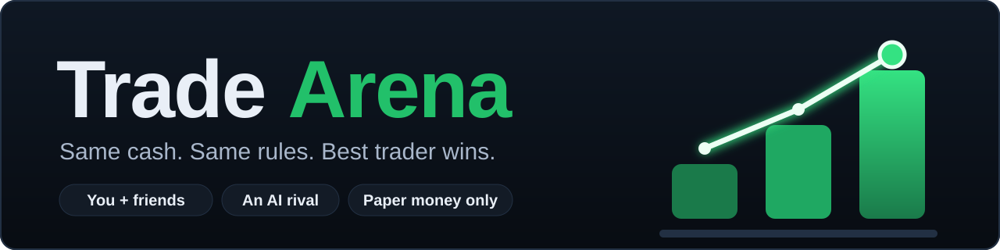
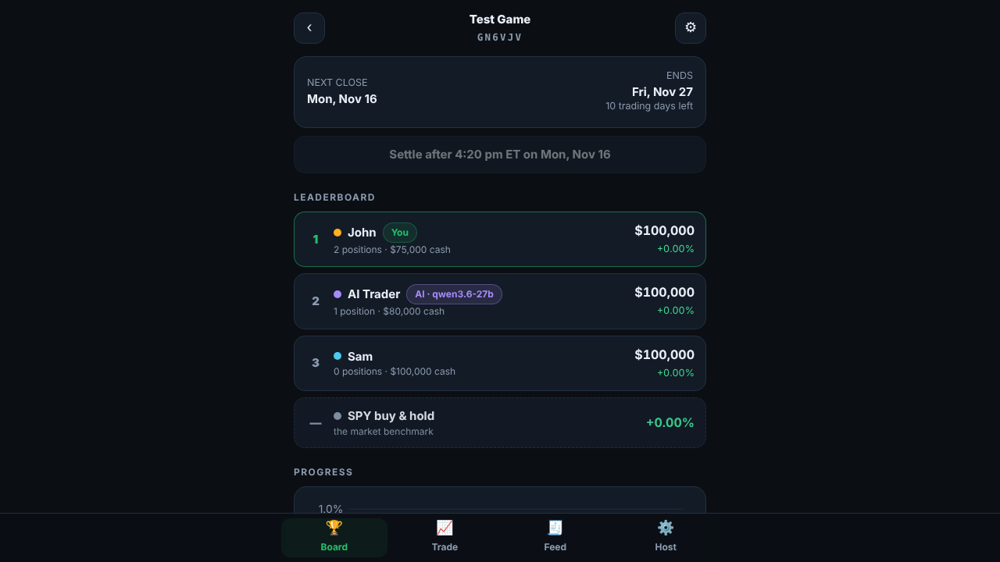
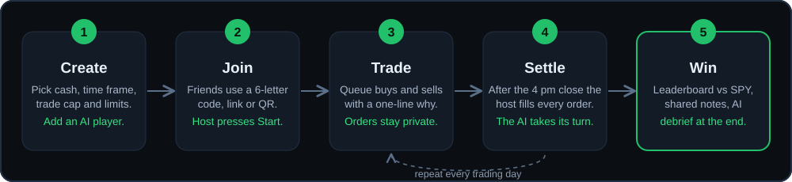
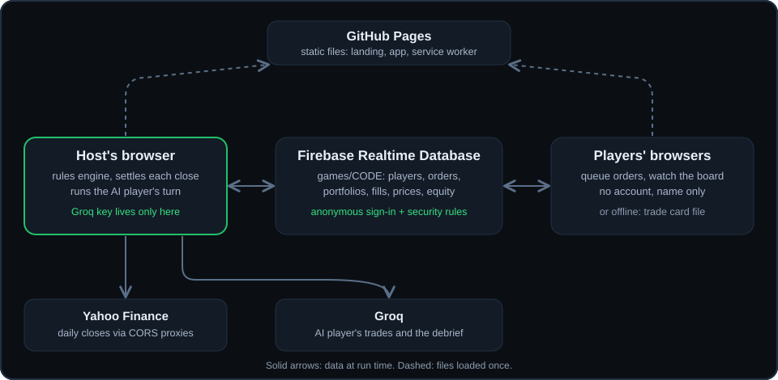

<p align="center"></p>

<p align="center">
<a href="https://johnlaz.github.io/trade/app/"><b>Play</b></a> · <a href="https://johnlaz.github.io/trade/">Landing page</a> · <a href="#set-up-online-play-firebase-free-spark-plan">Set up Firebase</a> · <a href="#ai-player">AI player</a>
</p>

<p align="center">


</p>

A paper-trading game for you, your friends and an AI player. Everyone starts with the same money, trades are capped, and orders fill at the closing price. Single-file PWA (`app/index.html`).

| | |
|---|---|
| Landing page | https://johnlaz.github.io/trade/ |
| App | https://johnlaz.github.io/trade/app/ |
| Join link format | `https://johnlaz.github.io/trade/app/?join=CODE` |



## How a game works



1. **Host** creates a game: starting cash, time frame, max trades per day, max positions, max % in one stock, and whether any US stock/ETF or only a list can be bought. Optionally adds an AI player.
2. **Players** join with a 6-character code, link or QR. Offline players get a game file and send back trade cards.
3. The host presses **Start**. Players queue orders any time. An order placed before 4:00 pm ET fills at that day's close; later orders fill at the next trading day's close.
4. After 4:20 pm ET the host presses **Settle**. Prices are loaded, the AI takes its turn (using only data through the previous close), every order is validated by the same rules engine, and the leaderboard updates.
5. At the end date the game finishes, with a winner, a chart against a SPY buy-and-hold benchmark, and an optional AI debrief.

**1-day games:** choose "1 day" as the time frame for a quick round. Orders fill at the first close and the game is scored at the next close (two settles), so the result is who picked the best overnight movers.

Rules enforced for everyone, human or AI: long-only, whole shares, no leverage, daily trade cap, position cap, single-stock cap. Sells run before buys when a day is settled. Pending orders are private until the close; the Feed shows everyone's trades and notes afterward.

## Set up online play (Firebase, free Spark plan)

You only do this once, as the host. Players need nothing.

1. Go to <https://console.firebase.google.com> and sign in with a Google account. Choose **Create a project**, name it (for example `trade-arena`), and turn Google Analytics off.
2. In the left menu open **Build → Authentication → Get started → Sign-in method → Anonymous → Enable → Save**.
3. Open **Build → Realtime Database → Create database**. Pick a location, choose **Start in locked mode**, and click Enable. (Do not use Firestore.) Spark needs no credit card.
4. On the **Rules** tab, delete everything, paste the contents of `docs/firebase-rules.json`, and click **Publish**.
5. Open **Project settings** (gear icon) → **General** → scroll to **Your apps** → click the web icon `</>` → give it a nickname → **Register app**. Copy the `firebaseConfig` values.
6. Either paste the config into the `FIREBASE_CONFIG` block near the top of the script in `app/index.html` (so every player gets it automatically), or on your own device open **Settings → Online play** and paste it there. The first option is what you want for friends, since they just open your link.
7. Check the `databaseURL` line is present. If the console did not show it, copy it from the Realtime Database page (it looks like `https://your-project-default-rtdb.firebaseio.com`).

The config is safe to publish: access is controlled by the rules, not by hiding it. Note the rules let any signed-in player read a game if they have its code, but only the host can change scores, and players can only write their own orders.

## AI player

Add a free Groq key in **Settings → AI player**. The key and model choice stay in the host's browser only. The model list is pulled from your key; default is `qwen/qwen3.6-27b`. The AI sees a watchlist table (editable in Settings) and can only trade what the rules allow.

## No Firebase? Offline mode

Leave "Play online" off when creating a game. Share the **game file** from the Host tab; players load it under Join, pick their name, queue orders, and send a **trade card** back (share sheet, email or copy). The host imports it under Host → Import trade card. Cards can only be imported once.

## Price data

Daily bars come from Yahoo Finance's public chart endpoint through free CORS proxies (same hedged-race approach as AXIOM). For reliability you can add your own Cloudflare Worker URL in Settings. Prices are end-of-day for settlement, delayed for the order screen.

## Limits worth knowing

- The host's app does the settling, so the host's browser must be opened once after each close. Missed days settle later in order.
- If the host clears browser storage in an online game they lose host control (the game stays readable). Use Host → Backup now and then.
- Market holidays: if SPY has no bar for a day, the host is asked whether to skip it.
- Honor system for offline cards: the host can see exactly what each card contains before importing.

## Data and privacy



- No accounts. Online players are signed in anonymously by Firebase, and a name is all that is shown.
- Game data (players, portfolios, fills, prices, daily equity) lives in your Firebase Realtime Database under `games/{CODE}`. Pending orders are readable only by their owner and the host.
- The Groq key, model choice, watchlist and any proxy URL stay in the host's browser and are never written to Firebase or to exports.
- Delete a game from Host → Danger zone to remove its data from Firebase.

## Deploy and update

Push the repo root to GitHub Pages (Settings → Pages → `main` / root). To change the app: edit the parts in `src/`, run `./build.sh` (rebuilds `app/index.html`, stamps the service worker cache with the version from `src/20_data.js`, checks that every precached file and manifest asset exists), run the tests, push. Bump `APP_VERSION` in `src/20_data.js` for each release so installed copies update.

## Repo layout

```
/index.html          landing page
/README.md
/docs/firebase-rules.json
/docs/banner.svg, flow.svg, architecture.svg   README visuals
/app/index.html      the app (single file)
/app/manifest.json   PWA manifest
/app/sw.js           service worker
/app/icon-192.png, icon-512.png, shot-wide.png, shot-phone-*.png
/src, /test, build.sh   source parts, tests, build script (not needed to run the app)
```

Run `./build.sh` to rebuild `app/index.html` from `src/`, `node test/engine.test.js` for the rules tests.

## Changelog

- **1.1.1**: trade card email goes to lazlab.io@gmail.com; Host tab lists every human player's queued orders.
- **1.1.0**: added a 1-day game (fills at the first close, scored at the next close).
- **1.0.0**: first release. Green theme and app icon, online and offline (trade card) play, AI player with Groq model picker, daily-close settling, SPY benchmark, AI debrief.

&copy; 2026 LAZLAB Creations. All Rights Reserved.
